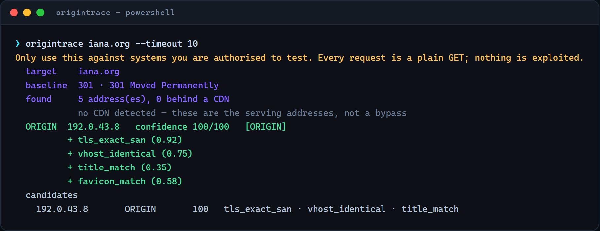
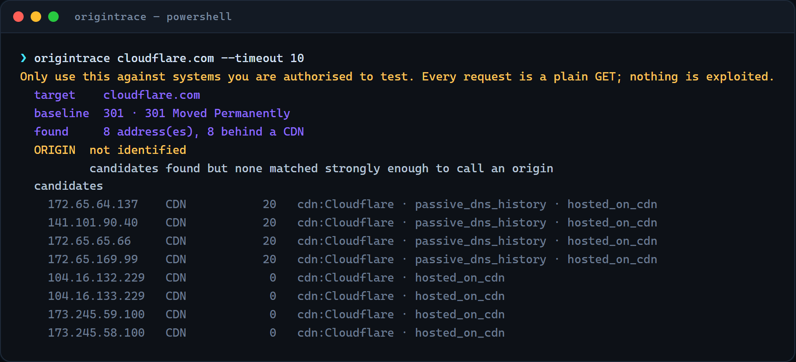
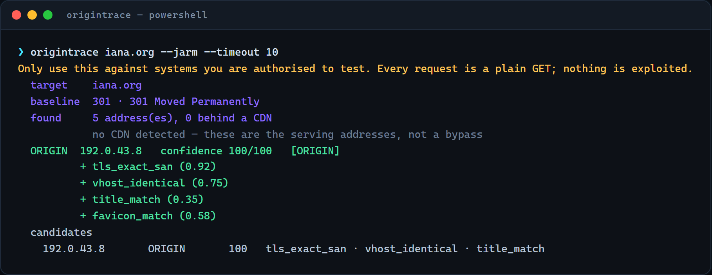
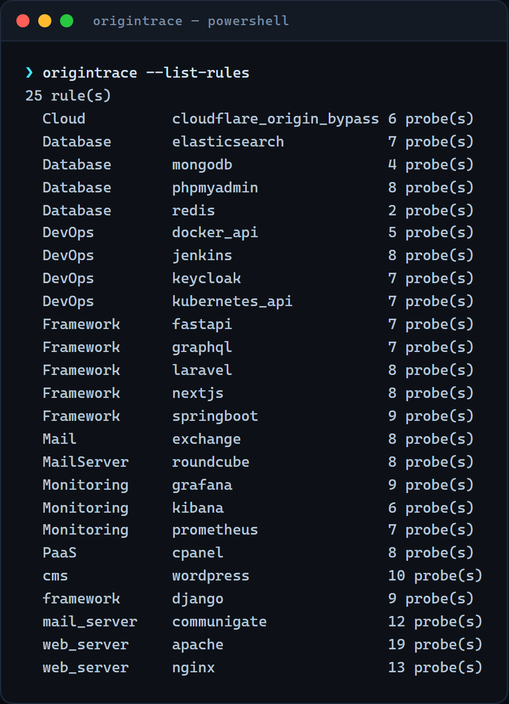

<div align="center">



# origintrace

**Find the server behind a CDN — and know why you believe it.**

[](tests)
[](pyproject.toml)
[](LICENSE)
[](pyproject.toml)
[](#datasets)

</div>

---

Most origin-discovery tools hand you forty IP addresses and leave the hard part
to you. `origintrace` is built around the opposite idea: **every claim about an IP
has to be backed by named, weighted evidence**, and the tool shows its work.

```
  target    example.com
  baseline  200 · Example Domain
  found     2 address(es), 2 behind a CDN

  ORIGIN  not identified
          candidates found but none matched strongly enough to call an origin
```

That is a correct answer, not a failure. `example.com` sits behind Cloudflare and
does not leak an origin. A tool that printed an IP here would be guessing.

---

## Why another origin tool

The existing options stop at *discovery* and never answer *"is this really the
site?"* — which is precisely where false positives come from.

| Failure mode | What most tools do | What origintrace does |
| :--- | :--- | :--- |
| **Catch-all vhost**<br>A server answering *any* hostname with the real page | Reports it as the origin | Probes a canary hostname; a match **disqualifies** the candidate |
| **CDN edge node**<br>The proxy itself matching on content | Reports the CDN IP | Classifies against **3,131 CIDR ranges** first, then never probes an edge |
| **Parked / mirror page**<br>Looks similar, is not the site | Scores it as a match | Blended sequence + token similarity, threshold tuned on real pages |

---

## Install

```bash
pip install .              # from a checkout
pip install -e ".[dev]"    # development
```

Python 3.9+, three runtime dependencies (`httpx`, `dnspython`, `PyYAML`).
Datasets and the YAML rule library ship **inside** the package, so an installed
copy works offline and needs **no API keys**.

```console
$ origintrace --datasets
cdn_networks     3131
waf_signatures   45
hosting_asns     66
```

---

## Quickstart

```bash
origintrace iana.org
```


Every line under the verdict is a signal with its contribution. Nothing is a
black box: `tls_exact_san` weighs 0.92 because a public CA issued a certificate
for that exact name to whoever controls that IP.

### A target that does not leak

```bash
origintrace cloudflare.com
```



Nine addresses found, all classified as Cloudflare edge nodes, **no origin
claimed**. This is the behaviour that matters — the tool refuses to guess.

---

## What it can do

```bash
origintrace example.com                 # the basics
origintrace example.com --all           # every technique
origintrace example.com --extended      # + 8 advanced passive sources
origintrace example.com --jarm          # active JARM-style TLS fingerprint
origintrace example.com --save reports  # JSON + Markdown artefacts
origintrace example.com --json          # for pipelines
origintrace --explain 203.0.113.9 -d example.com
```

<details>
<summary><b>All 22 flags</b></summary>

| Flag | Meaning |
| :--- | :--- |
| `-d, --domain NAME` | target domain when the positional argument is an IP |
| `--all` | enable every technique (`--extended` + `--hints` + fingerprinting) |
| `--extended` | advanced passive sources |
| `--jarm` | active JARM-style TLS fingerprint (ten `ClientHello`s per host) |
| `--progress` | stream each source's result to stderr as it completes |
| `--json` / `--markdown` | output format |
| `--save DIR` | write both artefacts |
| `-v, --verbose` | list every candidate, not just the top few |
| `--sub NAME` | extra subdomain hint (repeatable) |
| `--hints` | try the built-in hint wordlist |
| `--no-tls` | skip certificate identity checks |
| `--no-tlsfp` | skip TLS stack fingerprint comparison |
| `--no-favicon` | skip favicon comparison |
| `--timeout N` | per-request timeout (default 8s) |
| `--max N` | cap candidates to validate (default 40) |
| `--rules` | detect the stack from the rule library |
| `--probe-rules` | **send** the rules' probe paths (off by default) |
| `--datasets` | print dataset counts |
| `--list-rules` | print the rule library |
| `--version` | print the version and exit |

</details>

### Live progress

Passive sources complete at different speeds; `--progress` prints each result the
moment it lands instead of waiting for the slowest one.

```console
$ origintrace iana.org --hints --progress
  [baseline    ] fetching https://iana.org/
  [baseline    ] 301 · 301 Moved Permanently
  [discovery   ] 14 sources (0 advanced)
  [source:dns  ] 1 new address(es)
  [source:mx   ] 4 new address(es)
  [source:ct   ] 13 new address(es)
  [source:subdomains] 1 new address(es)
  [discovery   ] 8 candidate address(es)
  [classify    ] 2 behind a CDN, 17 direct
  [tlsfp       ] baseline TLSv1.3/TLS_AES_256_GCM_SHA384
  [validate    ] 192.0.43.8  4 signal(s)

  ORIGIN  192.0.43.8   confidence 100/100   [ORIGIN]
```

---

## How it works

```
   ┌──────────┐   ┌───────────┐   ┌──────────────┐   ┌────────────┐   ┌─────────┐
   │ baseline │──▶│ discovery │──▶│classification│──▶│ validation │──▶│ scoring │
   └──────────┘   └───────────┘   └──────────────┘   └────────────┘   └─────────┘
        │              │                  │                  │              │
   public page    19 passive        CDN / WAF /        cert SAN,      saturating
   = reference    sources, no       hosting lookup     vhost, canary, evidence
   for compare    target traffic    (skip edges)       favicon, JARM  → verdict
```

| Stage | What happens | Why it is ordered this way |
| :--- | :--- | :--- |
| **Baseline** | Fetch the public page | Without a reference, there is nothing to compare against — comparing against nothing is how a parking page gets reported as an origin |
| **Discovery** | 19 passive sources, zero packets to the target | Keeps the scan quiet and inside programs that forbid active scanning of ancillary hosts |
| **Classification** | CDN / WAF / hosting lookup | A Cloudflare edge never needs a vhost probe; skipping it saves most of the runtime |
| **Validation** | Per candidate, in order of signal strength | Each check answers one narrow question and returns *evidence*, not a boolean |
| **Scoring** | Saturating combination → verdict | Scoring reads evidence, so it must run last |

---

## The evidence model

Each observation is an `Evidence` with a **kind**, a **declared weight** and its
own **confidence**. Weights live in one table; no module does arithmetic.

Signals are grouped by how hard they are to fake:

| Group | Examples | Max weight |
| :--- | :--- | ---: |
| **Identity** | certificate SAN names the domain, TLS stack match | `0.92` |
| **Behaviour** | vhost returns the same page, same favicon | `0.75` |
| **Provenance** | certificate transparency, MX leak, SPF | `0.30` |

They combine by **saturation**, not addition:

```math
score = 1 - Π(1 - wᵢ)
```

Three signals at `0.5` give **`0.875`**, not `1.5`. That is why ten weak hints can
never outvote one certificate, and why a single strong signal cannot be inflated
past `1.0` by noise.

**Negative evidence subtracts and is named.** A catch-all vhost is not "the
absence of proof" — it is *disproof*, worth `0.85`, and the report says so.

### Verdict classes

| Class | Meaning |
| :--- | :--- |
| `EXPOSED_ORIGIN` | Serves the site and is not a CDN — the finding most hunters want |
| `PROTECTED_ORIGIN` | Serves the site but is still behind a WAF |
| `SHADOW_ORIGIN` | Serves the site but is shared hosting (`score < 0.80`) |
| `EDGE_NODE` | A CDN address — the thing you are trying to bypass |
| `HOSTING_ORIGIN` | Confirmed hosting provider |
| `UNCERTAIN` | Some evidence, below the `0.60` threshold |
| `REJECTED` | Disqualified: unreachable, catch-all, or a default page |

Full reasoning for every weight is in [`docs/EVIDENCE-MODEL.md`](docs/EVIDENCE-MODEL.md).

---

## Techniques

### Passive discovery — no traffic to the target

| Source | What it leaks | Flag |
| :--- | :--- | :--- |
| DNS `A` | the reference point | always |
| `MX` | mail servers, which rarely sit behind a CDN | always |
| Certificate Transparency | hostnames that were issued certificates | always |
| Shodan InternetDB | sibling hostnames on the same address | always |
| Subdomain hints | `direct`, `origin`, `staging`, `internal`, … | `--hints` |
| **SPF** | `ip4:` / `a:` / `include:` entries name mail infrastructure | `--extended` |
| **DMARC** | `rua=` / `ruf=` reporting hosts | `--extended` |
| **TXT verification** | hosts that claimed the domain | `--extended` |
| **robots.txt** | admin and staging hosts listed by name | `--extended` |
| **sitemap.xml** | hosts the marketing site never links to | `--extended` |
| **Content-Security-Policy** | every origin the page may talk to | `--extended` |
| **Generic header scan** | any header embedding a hostname under the domain | `--extended` |
| **Certificate SAN expansion** | siblings on the site's own certificate | `--extended` |
| **Reverse-IP** | other hostnames on the same address | `--extended` |
| **Wayback Machine** | hostnames from before the CDN existed | `--extended` |

### Active validation — one `GET /` per candidate

| Check | Question it answers |
| :--- | :--- |
| Certificate SAN | Does this IP hold a certificate naming the domain? |
| Vhost behaviour | Does it serve the site when asked for this `Host`? |
| **Catch-all canary** | Does it serve *anything* for any hostname? *(disqualifies)* |
| Content similarity | Is the page the same, after stripping nonces? |
| Favicon hash | Same icon? Survives CDNs and content edits. |
| Header fingerprint | Same stack, after removing volatile headers? |
| Title match | Same `<title>`? |
| **TLS stack fingerprint** | Same negotiated version / cipher / ALPN? |
| **JARM-style fingerprint** | Same answer to ten deliberately unusual `ClientHello`s? |
| Challenge detection | Is a WAF interstitial refusing us? *(disqualifies)* |

### Safety guard

Non-routable addresses — private, loopback, link-local, multicast, reserved and
documentation ranges — are **dropped at discovery time**. A leaked internal
hostname (an MX pointing at `10.32.10.95`) must never cause a probe of the
operator's own network. Parametrised tests pin this.

---

## TLS fingerprinting: two layers, one honest limit

| Layer | Cost | What it sees | Module |
| :--- | :--- | :--- | :--- |
| **Stack fingerprint** | 1 handshake | negotiated version, cipher, ALPN, legacy-protocol support | `tlsfp.py` |
| **JARM-style** | ~20 connections | the server's answer to ten *deliberately unusual* `ClientHello`s | `jarm.py` |

The second layer exists because the first cannot separate stacks that agree on
TLS 1.3 + AES-256-GCM. Varying cipher order, extension set and ALPN makes the
server reveal its preferences.

```console
$ origintrace iana.org --jarm
  [jarm        ] baseline ca5af2537d91b0fe92851875…
```



> [!IMPORTANT]
> This is **JARM-style, not byte-compatible with Salesforce JARM.** The probe
> table follows the published ten probes and the output uses the 62-character
> form, but the packets are built here rather than replayed from the reference
> implementation. Fingerprints **discriminate stacks correctly**; they are
> **not comparable** with values in public JARM databases. The weight
> (`TLS_JARM_MATCH`, `0.45`) reflects a corroborating signal, not proof.

Measured against live hosts:

| Host | Fingerprint |
| :--- | :--- |
| `iana.org` | `ca5af2537d91b0fe928518750e5d74.e3b0c44298fc1c149afbf4c8996fb924` |
| `badssl.com` | `701ddd16c7048ce02e4ae52ef32004.7d0228bedcaf78899179f2cb20b900cb` |
| Cloudflare-fronted | `3ceab2c84328909c80395d2c67ed21.4f349fb90db45cb71fc292fd804d3488` |

---

## Rule library

25 YAML rules across frameworks, web servers, databases, DevOps tooling, mail
servers and monitoring. A rule has a `detection` block (always safe, read-only)
and a `probes` block (**only** with `--probe-rules`).



```yaml
name: nextjs
category: Framework
detection:
  body_patterns:
    - pattern: "__NEXT_DATA__"
      confidence: 95
probes:
  - path: "/__nextjs_build_id"
    method: GET
    risk: LOW
```

A probe hit is only marked `confirmed` when the status matched **and** a
soft-404 guard saw different content for a random path — otherwise every SPA
router's `200 OK` becomes a finding.

---

## Safety and scope

- **Only plain `GET /` requests.** No exploitation, no fuzzing, no payloads.
- `--probe-rules` is the **single exception** and is off by default, because some
  bundled probe paths are real attacks and will get you banned if fired blindly.
- TLS verification is disabled when reading certificates. This is deliberate:
  origin servers routinely present expired or self-signed certificates and the
  SAN entries are still the strongest identity signal available. The certificate
  is read and **not trusted**.
- The tool will not police your scope — **you** are responsible for holding
  authorisation. The scope reminder prints on every run and cannot be suppressed.

---

## Datasets

| Dataset | Entries | Source |
| :--- | ---: | :--- |
| CDN CIDR ranges | 3,131 networks / 15 providers | published provider ranges |
| WAF signatures | 45 vendors | header names, header **values**, cookies, body markers |
| Hosting ASNs | 66 providers | shared-hosting / cloud ASNs |

Two WAF files ship: `waf_signatures.json` matches header *names*;
`waf_signatures_extra.json` layers header *value* rules on top, because most
vendors identify themselves in `server` or `via`. Keeping them separate makes the
provenance of every added rule obvious.

---

## Testing

```bash
pytest
```

**156 tests, all offline.** The network is faked at the module boundary, so the
suite proves *decision logic* rather than your internet connection — and the
weights are pinned, so an accidental change to the scoring model fails the build.

| Area | Tests | What is pinned |
| :--- | ---: | :--- |
| Evidence & scoring | 14 | saturation bounds, thresholds, disqualifiers, order independence |
| Certificate parsing | 18 | SAN extraction, wildcard coverage, the `getpeercert()` trap |
| JARM | 19 | packet lengths, mandatory 1.3 extensions, ServerHello parsing |
| Pipeline | 22 | stage order, CDN skip, failure handling, report formats |
| Sources & safety | 31 | SPF/CSP/robots parsing, non-routable guard |
| WAF coverage | 20 | 20 vendors, 6 CDN ranges |

---

## Project layout

```
origintrace/
├── models.py      data model: Candidate, Evidence, Verdict, ScanContext
├── evidence.py    weights, saturation, classification
├── intel.py       CDN / WAF / hosting datasets
├── discover.py    passive source driver + non-routable guard
├── sources.py     advanced passive sources (SPF, CSP, robots, wayback, …)
├── probe.py       HTTP, TLS, DNS primitives
├── tlsfp.py       TLS stack fingerprinting (negotiated parameters)
├── jarm.py        JARM-style active fingerprint (ten crafted ClientHellos)
├── validate.py    certificate identity, vhost behaviour, similarity
├── rules.py       YAML detection engine
├── pipeline.py    stage orchestration + live progress
├── report.py      console / JSON / Markdown
├── cli.py         argument parsing
├── data/          shipped datasets
└── rules/         25 YAML rules
tests/             156 offline tests
docs/              architecture and evidence model
```

---

## Known limits

- **Bypass of a real, well-configured edge is not guaranteed.** Cloudflare's
  best-configured zones do not leak an origin, and the tool reports that instead
  of inventing one.
- **JARM is not byte-compatible** with the reference implementation — see above.
- **No live test against a target with a genuinely leaked origin.** Those require
  a target you are authorised on; the logic is pinned by 156 offline tests and
  validated against hosts that *do* and *do not* leak.
- **Wildcard DNS** targets resolve everything to one address, and `--max` caps
  the work but cannot tell which candidate is real.

---

## Licence

MIT — see [`LICENSE`](LICENSE).

> [!WARNING]
> **Authorised use only.** Use this exclusively against systems for which you
> hold explicit, documented authorisation: an engagement contract, a bug bounty
> scope that permits the activity, or systems you own. Enumerating infrastructure
> outside an authorised scope can violate computer-misuse law and the terms of
> the program you are working under.
